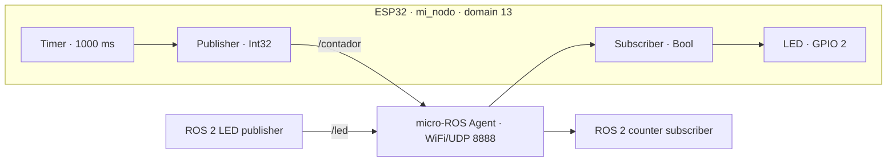

<div align="center">

# 🚀 ESP32 micro-ROS Template

### Reusable ROS 2 Nodes with PlatformIO, Arduino, and WiFi Transport


[](LICENSE)

<p>
An educational starting point for <b>ESP32 applications connected to ROS 2 Humble</b> through micro-ROS. A reusable helper handles initialization so you can focus on messages, callbacks, sensors, and actuators.
</p>

</div>

---

## 📑 Table of Contents

1. [Project Overview](#project-overview)
2. [Requirements](#requirements)
3. [Step 1: Download and Open the Project](#step-1-download-and-open-the-project)
4. [Step 2: Configure Hardware and WiFi](#step-2-configure-hardware-and-wifi)
5. [Step 3: Start the micro-ROS Agent](#step-3-start-the-micro-ros-agent)
6. [Step 4: Build and Upload the Firmware](#step-4-build-and-upload-the-firmware)
7. [Step 5: Verify ROS 2 Communication](#step-5-verify-ros-2-communication)
8. [Software Architecture and Topic Contract](#software-architecture-and-topic-contract)
9. [Create Your Own Application](#create-your-own-application)
10. [Repository Structure](#repository-structure)
11. [Troubleshooting](#troubleshooting)
12. [Current Scope](#current-scope)
13. [Author, Institution, and License](#author-and-contributions)

---

<a id="project-overview"></a>
## 🗺️ Project Overview

The included example runs a node named `mi_nodo`. It publishes an integer counter once per second and receives independent commands to control an LED.

| Component | Purpose | File |
| --- | --- | --- |
| Working example | Publish a counter and receive LED commands | [src/main.cpp](src/main.cpp) |
| Application skeleton | Start a node and add your own ROS entities | [examples/template_main.cpp.txt](examples/template_main.cpp.txt) |
| Reusable helper | Initialize transport, domain, node, executor, and entities | [include/MicroROSHelper.h](include/MicroROSHelper.h) |
| PlatformIO environment | Configure the board, framework, and dependencies | [platformio.ini](platformio.ini) |

The example counter starts at `1`, increases on each timer callback, and returns to `0` after `INT32_MAX`. LED commands do not change or pause the counter.

---

<a id="requirements"></a>
## 🧰 Requirements

- An ESP32 board compatible with the `denky32` environment, or an adjusted PlatformIO board configuration.
- A USB data cable.
- Visual Studio Code with **PlatformIO IDE already installed and configured**. This guide assumes a working PlatformIO environment.
- Git available for cloning the template.
- A computer with **ROS 2 Humble** and an available `micro_ros_agent` package.
- A **2.4 GHz WiFi network** allowing communication between the ESP32 and the Agent computer.
- Internet access for the first dependency download.

The Agent is a separate program on the computer. PlatformIO builds the ESP32 client firmware; it does not install the host Agent.

---

<a id="step-1-download-and-open-the-project"></a>
## 📥 Step 1: Download and Open the Project

Clone the template and **remove its Git metadata before starting your own project**. Run these commands in order; `rm -rf .git` must run inside the newly cloned folder:

```bash
git clone https://github.com/d3im3r/esp32-microros-template.git
cd esp32-microros-template
rm -rf .git
```

Removing `.git` is a required step in this template workflow. It deletes the clone's commit history, branches, and remote configuration while preserving the project files, license, and attribution. It does not modify the original GitHub repository.

If you want to track your application in a new repository, initialize a fresh history:

```bash
git init -b main
```

Open the cloned folder containing `platformio.ini` in your configured PlatformIO environment.

---

<a id="step-2-configure-hardware-and-wifi"></a>
## 🔌 Step 2: Configure Hardware and WiFi

### 2.1. Hardware

| Component | ESP32 Pin | Behavior |
| --- | --- | --- |
| LED | `GPIO 2` | Active high: `true` turns it on; `false` turns it off |
| USB | Board USB connector | Firmware upload and serial diagnostics at `115200` baud |

Check whether your board has an onboard LED on GPIO 2. Adjust `LED_PIN` if needed. For an external LED, use a suitable current-limiting resistor and a common ground. For an active-low LED, invert the callback output levels and initialize the pin to `HIGH` for the off state.

### 2.2. Connection Settings

Replace the existing network values in [src/main.cpp](src/main.cpp) with your own settings:

```cpp
const size_t ROS_DOMAIN = 13;
const size_t EXECUTOR_HANDLES = 2; // One subscriber and one timer.
char WIFI_SSID[] = "YOUR_WIFI_SSID";
char WIFI_PASSWORD[] = "YOUR_WIFI_PASSWORD";
IPAddress AGENT_IP(192, 168, 1, 100);
const uint16_t AGENT_PORT = 8888;
const char NODE_NAME[] = "mi_nodo";
```

The IP above is an example. Set `AGENT_IP` to the reachable IPv4 address of the computer running the Agent. Find it on that computer with:

```bash
hostname -I
ip -4 -br addr
ip route
```

Choose the interface connected to the ESP32 network. Do not use a loopback address such as `127.0.0.1` or copy a network suffix such as `/24` into `IPAddress`.

> [!IMPORTANT]
> Keep real WiFi credentials out of published files. Review `src/main.cpp` and the files in `examples/` before committing network configuration.

### 2.3. Included Build Environment

[platformio.ini](platformio.ini) already defines `denky32`, the Arduino framework, micro-ROS Humble, WiFi transport, and a serial monitor speed of `115200` baud. Use this environment for a compatible board.

The micro-ROS client library is provided locally in `lib/micro_ros_platformio/`. Its Git URL in `lib_deps` is currently commented out. Keep the local library directory: it supplies the transport implementation and micro-ROS build integration.

The active `lib_deps` entries provide Adafruit display and sensor libraries for extensions. The counter/LED example does not use those peripherals.

---

<a id="step-3-start-the-micro-ros-agent"></a>
## 🤖 Step 3: Start the micro-ROS Agent

In a terminal on the Agent computer:

```bash
source /opt/ros/humble/setup.bash
# If the Agent was built in a workspace, also source its install/setup.bash.
export ROS_DOMAIN_ID=13
ros2 pkg prefix micro_ros_agent
ros2 run micro_ros_agent micro_ros_agent udp4 --port 8888
```

Keep this terminal open. Start the Agent before the ESP32 initializes its ROS entities.

The firmware, Agent, and ROS 2 CLI terminals must use the same domain. The environment variable is case-sensitive: `ROS_DOMAIN_ID`.

<details>
<summary>🔎 Check the host environment and UDP listener</summary>

Run these checks in another terminal:

```bash
source /opt/ros/humble/setup.bash
export ROS_DOMAIN_ID=13
echo "$ROS_DISTRO"
echo "$ROS_DOMAIN_ID"
printenv ROS_LOCALHOST_ONLY RMW_IMPLEMENTATION
ss -lunp 'sport = :8888'
```

If `ROS_LOCALHOST_ONLY` is `1`, set `export ROS_LOCALHOST_ONLY=0` before starting the Agent and the ROS 2 CLI tools for this networked setup. Check that host firewall and router settings allow the required traffic.

</details>

---

<a id="step-4-build-and-upload-the-firmware"></a>
## 🚀 Step 4: Build and Upload the Firmware

Connect the ESP32 over USB, then run these tasks from **PlatformIO → PROJECT TASKS → denky32**:

| Order | Task | Expected Result |
| :---: | --- | --- |
| 1 | **Build** | Compilation completes with `SUCCESS` |
| 2 | **Upload** | Firmware is transferred to the ESP32 |
| 3 | **Monitor** | WiFi diagnostics followed by `Nodo listo` at `115200` baud |

If the firmware started before the Agent, reset the board after the Agent is running.

Alternatively, when the PlatformIO CLI is available in your terminal:

```bash
pio run
pio run --target upload
pio device monitor --baud 115200
```

<details>
<summary>🔌 Select a USB port manually</summary>

Identify the board's device:

```bash
ls /dev/ttyUSB* /dev/ttyACM* 2>/dev/null
ls -l /dev/serial/by-id/
```

If automatic detection fails, add the actual port under `[env:denky32]`:

```ini
upload_port = /dev/ttyUSB0
monitor_port = /dev/ttyUSB0
```

Close the monitor before uploading if it keeps the port busy.

</details>

---

<a id="step-5-verify-ros-2-communication"></a>
## 📡 Step 5: Verify ROS 2 Communication

In **each additional terminal**, load ROS 2 and set the domain:

```bash
source /opt/ros/humble/setup.bash
export ROS_DOMAIN_ID=13
```

### 5.1. Inspect the Node and Topics

```bash
ros2 node list
# Expected node: /mi_nodo

ros2 node info /mi_nodo
ros2 topic list -t
# Application topics: /contador and /led

ros2 interface show std_msgs/msg/Int32
ros2 interface show std_msgs/msg/Bool
```

### 5.2. Observe the Counter

```bash
ros2 topic echo /contador
```

Expected values are `1, 2, 3, ...`; the first observed value depends on when you subscribe. In another terminal, measure the publication frequency:

```bash
ros2 topic hz /contador
```

The expected rate is approximately **1 Hz**. Timing can vary with network conditions and callback execution.

### 5.3. Control the LED

```bash
# Turn the LED on.
ros2 topic pub --once /led std_msgs/msg/Bool "{data: true}"

# Turn the LED off.
ros2 topic pub --once /led std_msgs/msg/Bool "{data: false}"
```

The LED starts off and retains the last requested state. The counter continues independently and restarts when the ESP32 resets.

---

<a id="software-architecture-and-topic-contract"></a>
## ⚙️ Software Architecture and Topic Contract



| Topic | Message Type | ESP32 Role | Meaning |
| --- | --- | --- | --- |
| `/contador` | `std_msgs/msg/Int32` | Publisher | Counter value, approximately once per second |
| `/led` | `std_msgs/msg/Bool` | Subscriber | `true`: LED on; `false`: LED off |

The executor services one subscription and one timer. The publisher sends from the timer callback.

---

<a id="create-your-own-application"></a>
## 🛠️ Create Your Own Application

### 1. Start from the Skeleton

Copy [examples/template_main.cpp.txt](examples/template_main.cpp.txt) into `src/main.cpp` to replace the counter/LED example. The skeleton initializes a node with **zero executor handles** and provides placeholders for your application logic. `.txt` examples are not compiled.

1. Choose your message types, topic names, data directions, and update periods.
2. Declare input and output messages separately.
3. Add the publishers, subscriptions, and timers you need.
4. Implement hardware setup and brief callbacks.
5. Create the required entities in `setup()` and check their initialization results.
6. Set the executor handle count and validate with the Agent.

### Available Examples

Copy the contents of one example into `src/main.cpp`, configure its WiFi credentials and Agent IP, then build and upload. Keep `MicroROSHelper.h` and the existing PlatformIO dependencies.

| Example | Behavior | Handles |
| --- | --- | :---: |
| [template_main.cpp.txt](examples/template_main.cpp.txt) | Brief student guide with numbered steps and application placeholders | `0` |
| [publisher.cpp.txt](examples/publisher.cpp.txt) | Publish `/contador` (`Int32`) at approximately 1 Hz | `1` |
| [subscriber.cpp.txt](examples/subscriber.cpp.txt) | Receive `/led` (`Bool`) to control GPIO 2 | `1` |
| [publisher_subscriber.cpp.txt](examples/publisher_subscriber.cpp.txt) | Receive `/entrada` (`Int32`), publish twice its value on `/salida` | `1` |

The combined example publishes from the subscription callback and needs no timer. Values whose double would exceed the `Int32` range are rejected. The template includes node-discovery checks; the other examples include topic commands for manual verification.

### 2. Calculate Executor Handles

```text
handles = number of subscriptions + number of timers
```

| Application | Handles |
| --- | :---: |
| Node without subscriptions or timers | `0` |
| One publisher driven by one timer | `1` |
| One subscriber | `1` |
| One subscriber and one timer | `2` |
| Publish directly in a subscription callback, without a timer | `1` |

Publishers do not consume executor handles just by existing. Avoid long delays or blocking loops inside callbacks.

### 3. Use the Helper

| Method | Responsibility |
| --- | --- |
| `beginWiFi()` | Initialize WiFi transport, domain, node, and executor |
| `beginSerial()` | Initialize the node using Serial transport |
| `createPublisher()` | Create a publisher |
| `createSubscription()` | Create and register a subscription |
| `createTimer()` | Create and register a timer with a period in milliseconds |
| `publish()` | Send a message |
| `spinSome()` | Process executor events |
| `require()` | Stop execution after a critical failure |
| `info()` | Print diagnostics when WiFi transport is enabled |
| `wifiConnected()` | Check WiFi connection status |
| `lastError()` / `lastStep()` | Inspect the last recorded operation result |

For example, change `COUNT_PERIOD_MS` in `main.cpp` to `500` to publish approximately twice per second:

```cpp
const uint32_t COUNT_PERIOD_MS = 500;
```

### 4. Optional: Switch to Serial Transport

Change the build-time transport in `platformio.ini`:

```ini
board_microros_transport = serial
```

Replace the WiFi initialization in `setup()` with:

```cpp
bool ok = ros.beginSerial(NODE_NAME, EXECUTOR_HANDLES, ROS_DOMAIN, Serial, 115200);
ros.require(ok, "Error inicializando micro-ROS");
```

Also remove the WiFi connection guard from `loop()` and keep executor processing:

```cpp
void loop()
{
    ros.spinSome(10);
    delay(10);
}
```

This change is required because `wifiConnected()` returns `false` when built without WiFi transport.

Rebuild and upload, close the serial monitor, then run the Agent on the board's actual port:

```bash
source /opt/ros/humble/setup.bash
export ROS_DOMAIN_ID=13
ros2 run micro_ros_agent micro_ros_agent serial --dev /dev/ttyUSB0 -b 115200
```

The Agent uses the serial port exclusively. Helper diagnostic prints are disabled for Serial transport to avoid interfering with protocol traffic.

---

<a id="repository-structure"></a>
## 📁 Repository Structure

```text
esp32-microros-template/
├── README.md                    # Project presentation and usage guide
├── LICENSE                      # Apache License 2.0
├── platformio.ini               # Board, framework, transport, and dependencies
├── .gitignore                   # Current Git tracking rules
├── include/
│   └── MicroROSHelper.h         # Reusable micro-ROS infrastructure
├── src/
│   └── main.cpp                 # Counter/LED firmware compiled by PlatformIO
├── examples/                    # Copy one example into src/main.cpp to use it
│   ├── template_main.cpp.txt    # Starting point for custom applications
│   ├── publisher.cpp.txt        # Publish an Int32 counter at 1 Hz
│   ├── subscriber.cpp.txt       # Receive Bool commands for the LED
│   └── publisher_subscriber.cpp.txt # Receive an Int32 and publish its double
└── lib/
    └── micro_ros_platformio/    # Local third-party micro-ROS library
        ├── library.json         # PlatformIO library metadata
        ├── extra_script.py      # micro-ROS build integration
        ├── platform_code/       # Transport implementations
        ├── microros_utils/      # Build utilities
        ├── metas/               # micro-ROS build profiles
        ├── LICENSE              # Upstream license
        ├── NOTICE               # Upstream attribution
        └── ...                  # Upstream documentation, examples, and CI
```

The tree shows the project files and the main parts of the bundled library. The local `test/` directory is empty and contains no implemented tests. PlatformIO stores downloaded project dependencies and build artifacts in `.pio/`. The current `.gitignore` excludes local editor settings in `.vscode/`; `.pio/` is not excluded by that file.

---

<a id="troubleshooting"></a>
## 🔧 Troubleshooting

| Issue | Probable Cause | What to Check or Do |
| --- | --- | --- |
| ESP32 cannot connect to WiFi | Incorrect credentials, coverage, or network band | Verify SSID, password, and a reachable 2.4 GHz network |
| micro-ROS initialization fails | Agent unavailable or wrong endpoint | Start the Agent, check its IP and UDP port, then reset the ESP32 |
| Node does not appear | Domain mismatch or network restrictions | Use domain `13` in the firmware, Agent, and CLI; check network isolation and firewall |
| `/contador` receives no data | Timer, publisher, or executor issue | Check entity initialization and continued calls to `spinSome()` |
| LED does not respond | Wrong pin, polarity, topic, or message type | Check GPIO 2, wiring, `/led`, and `std_msgs/msg/Bool` |
| New subscription or timer fails | Insufficient executor capacity | Recalculate subscriptions + timers and update `EXECUTOR_HANDLES` |
| `micro_ros_agent` package not found | Agent missing or workspace not sourced | Install/build the Agent separately and source its workspace |
| USB port is missing or busy | Cable, access permissions, or another process | Check the device path, Linux serial access, and close the monitor |
| Monitor shows `Programa detenido` | A critical operation failed | Read the reported step and error code, correct the cause, and reset |
| Invalid ELF header during build | Incomplete or damaged build artifacts | Run `pio run --target clean`, then `pio run` |
| Serial version never services callbacks | WiFi guard remains in `loop()` | Remove that guard as described in the Serial transport section |

---

<a id="current-scope"></a>
## 📌 Current Scope

- The template initializes one micro-ROS session. It does not automatically rebuild ROS entities after the Agent restarts or a session is lost.
- On WiFi loss, the example pauses executor processing until WiFi is connected again. The LED retains its last state; this does not restore a lost Agent session.
- `require()` stops the application after critical failures. Publication failures are logged; the example does not handle the return value of `spinSome()`.
- Dependencies are not fully pinned to exact versions or commits.
- Build success verifies compilation. Hardware behavior and ROS 2 communication require the board and a running Agent.

---

<a id="author-and-contributions"></a>
## 👤 Author, Institution, and License

**Deimer Miranda Montoya, MSc.(c)** — demiranda@unal.edu.co / deimer_miranda91162@elpoli.edu.co

**Institution:** Politécnico Colombiano Jaime Isaza Cadavid — Faculty of Engineering

**License:** [Apache License 2.0](LICENSE)

The bundled `lib/micro_ros_platformio/` library retains its upstream [LICENSE](lib/micro_ros_platformio/LICENSE), [NOTICE](lib/micro_ros_platformio/NOTICE), and [third-party license information](lib/micro_ros_platformio/3rd-party-licenses.txt).

### Contributions

To report a problem or propose an improvement, include your board model, relevant configuration, reproduction steps, and build or monitor output. For firmware changes, describe the build result and any checks performed with the Agent and ROS 2 topics. Remove credentials from shared logs and examples.

